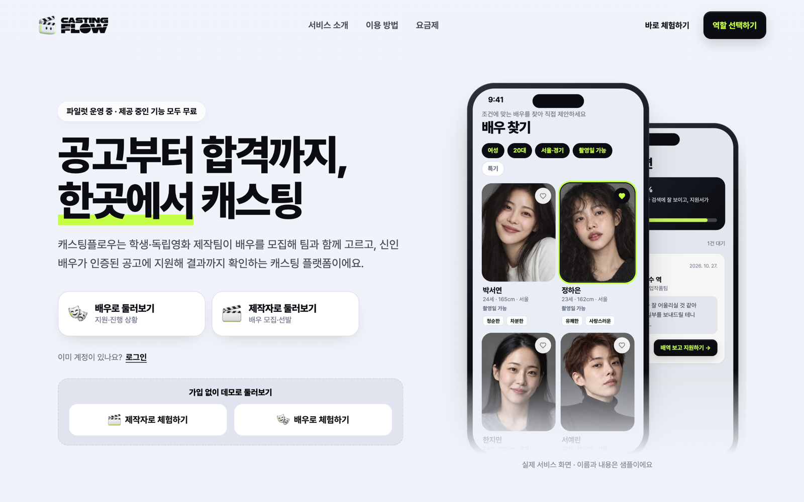
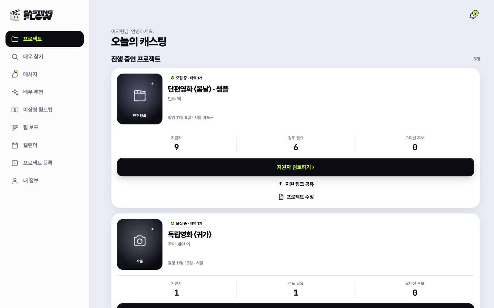
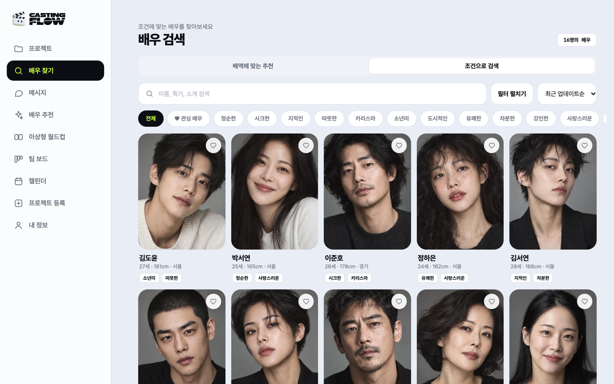
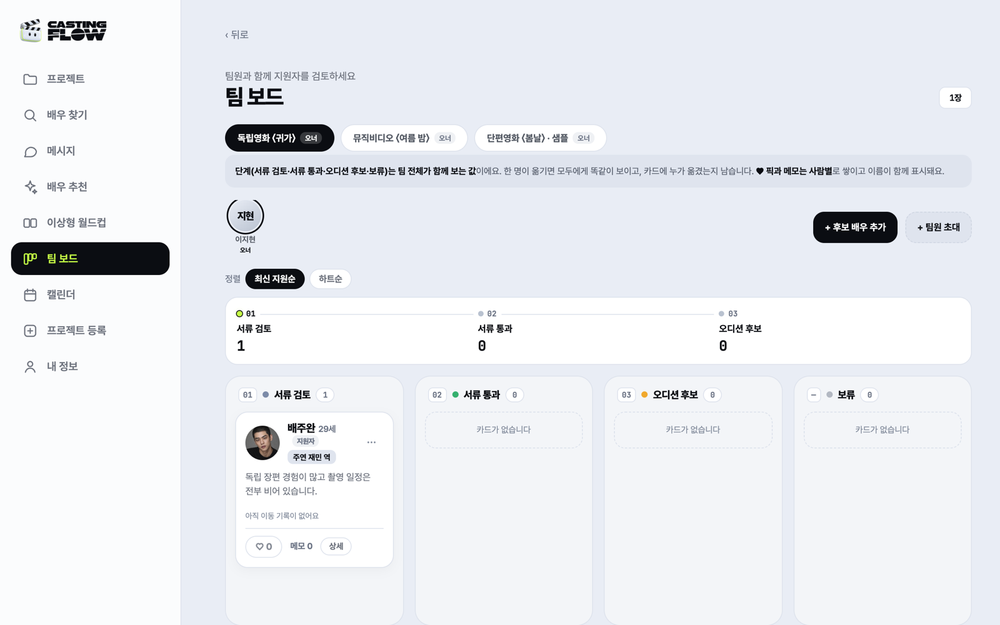
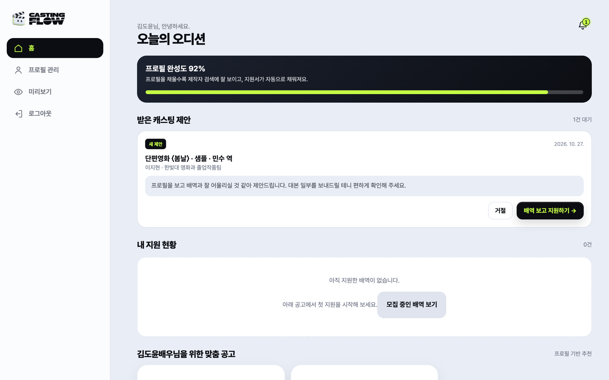
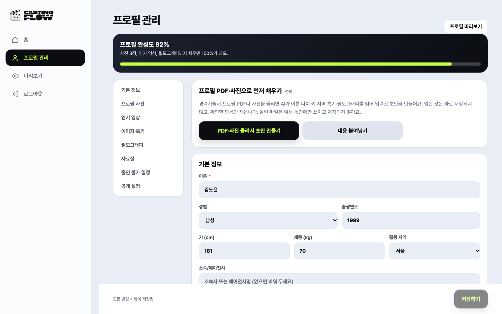

<div align="center">


<br>


# 캐스팅플로우

### Casting Flow — 공고부터 합격까지, 한곳에서 캐스팅

학생·독립영화 제작팀은 배우를 **모집하고 팀과 함께 고르고**,
신인 배우는 **인증된 공고에 지원해 결과까지** 확인하는 캐스팅 플랫폼입니다.

배우는 앱 설치 없이 공유된 링크로 바로 지원합니다. 모바일 퍼스트 **반응형 웹(PWA)** 입니다.

<br>

[](https://nextjs.org)
[](https://react.dev)
[](https://www.typescriptlang.org)
[](https://supabase.com)
[](#-검증-명령)
[](src/app/manifest.ts)

<br>

[운영 사이트](https://casting-swipe.vercel.app) · [체험(데모) 사이트](https://casting-swipe-demo.vercel.app) · [빠른 시작](#-빠른-시작) · [주요 기능](#-주요-기능) · [구조](#-구조) · [로드맵](#️-다음-할-일)

```bash
pnpm install && cp .env.example .env.local && pnpm dev
```

</div>

---

<div align="center">

| 랜딩 | 제작자 · 프로젝트 |
|:---:|:---:|
|  |  |
| **제작자 · 배우 검색** | **제작자 · 팀 보드** |
|  |  |
| **배우 · 홈** | **배우 · 프로필 관리** |
|  |  |

<sub>체험 사이트 화면 · 이름과 사진은 샘플입니다</sub>

</div>

---

## ✨ 주요 기능

**제작진** — 지원자가 많아도 팀과 함께 빠르게 정해요

| 기능 | 화면 | 내용 |
|---|---|---|
| 프로젝트·배역 | `/studio`, `/studio/projects/new` | 등록 마법사(임시 저장), 촬영 일정·출연료·**특수 장면 안내** 등 공고 필수 항목, 배역별 공개 지원 링크 |
| 지원자 검토 | `/studio` | 지원자 목록·필터·내부 메모, 공개 결과 단계 관리. 처음 열면 배우에게 '검토 중'으로 표시 |
| 배우 찾기 | `/studio/actors` | 배역에 맞는 추천 / 조건 검색(성별·연령·키·지역·이미지·특기·촬영 가능일), 관심 배우 저장 |
| 배우 추천 | `/studio/recommend` | 배역 조건과 프로필을 비교한 **조건 기반 적합도 %** + 추천 이유 (외모 평가·자동 결정 없음) |
| 이상형 월드컵 | `/studio/compare` | 후보를 1:1로 붙여 최종 1인 선택, 결과 저장 |
| 팀 보드 | `/studio/board` | 서류 검토 → 서류 통과 → 오디션 후보 → 보류, 팀원 하트·메모, 이동 기록, 이메일 초대, 지원하지 않은 배우도 후보로 추가 |
| 오디션 캘린더 | `/studio/calendar` | 월간/목록 뷰, 메시지에서 확정한 오디션 자동 반영, 대면/비대면·장소, 시간 충돌 감지 |
| 메시지 | `/studio` (메시지 탭) | 지원자별 대화, 오디션 시간 제안 → 배우 선택 → 확정, **대본·일정표 파일 첨부** |
| 제작진 인증 | `/studio/verify` | **학교 메일 6자리 코드** 또는 **재학증명서·서류 AI 확인**. 인증 배지는 공고에 표시, 미인증 팀은 "이전 작품 이력이 확인되지 않았어요" |

**배우** — 프로필 하나로 지원하고 결과까지 확인해요 (언제나 무료)

| 기능 | 화면 | 내용 |
|---|---|---|
| 프로필 관리 | `/me/profile` | **프로필 PDF·사진을 AI가 읽어 입력칸 초안 작성**(확인한 항목만 반영), 사진·연기 영상·이미지 태그·특기·필모그래피, PDF 자료실, 출연 불가 일정, 공개 설정 |
| 배우 홈 | `/me` | 프로필 완성도, 받은 캐스팅 제안 수락/거절, 내 지원 현황, 프로필 기반 맞춤 공고 |
| 배역 찾기 | `/actor` | 연령대·지역·형식·장르 필터, 공고마다 인증 여부와 촬영 조건을 지원 전에 확인 |
| 지원·현황 | `/apply/[slug]`, `/status/[token]` | **가입 없이도** 링크로 지원, 미열람 → 검토 중 → 오디션 대상 → 결과, 결과 안내 예정일, 오디션 시간 선택 |
| 촬영 참석 재확인 | `/status/[token]` | 출연 확정 후 촬영 D-3부터 참석 여부를 다시 확인 (노쇼 방지) |
| 결과 안내 지연 | `/status/[token]` | 결과 기준일이 지나도 소식이 없으면 자동 불합격이 아니라 '결과 안내 지연'으로 표시 |

**공개 화면**: 랜딩(`/`)의 역할별 이용 방법·실제 화면 미리보기, 로그인 전 제작진용 배우 프로필 둘러보기(`/actors`), 이용약관(`/terms`)·개인정보처리방침(`/privacy`), 문의하기(`/contact`: 일반·오류·개인정보·신고)

**계정·보안**: 이메일 가입(만 14세 이상·약관 동의), 비밀번호 재설정(`/reset`, 1회용 메일 링크), 회원 탈퇴(`/account/delete`) 시 관련 개인정보·파일 삭제, 지원 시 개인정보 수집·이용 동의, 로그인·가입·지원 요청 횟수 제한, PDF 자료는 로그인 사용자만 열람

---

## 🚀 빠른 시작

**요구사항**: Node.js 24+, pnpm

```bash
pnpm install
cp .env.example .env.local   # 아래 환경변수 채우기
pnpm dev                     # http://localhost:3000
```

| 환경변수 | 필수 | 설명 |
|---|:---:|---|
| `SESSION_SECRET` | ✅ | 24자 이상 임의 문자열 (세션 쿠키 서명) |
| `DATABASE_URL` | ✅ | Supabase Postgres 연결 문자열 (대시보드 Connect → Session pooler) |
| `SUPABASE_URL`, `SUPABASE_SECRET_KEY` | | 사진·PDF 저장(비공개 버킷 `uploads`). 없으면 로컬 `data/uploads/` |
| `ANTHROPIC_API_KEY` (+ `ANTHROPIC_BASE_URL`) | | AI 프로필 읽기·인증 서류 확인. 없으면 해당 기능은 '준비 중'으로 표시 |
| `RESEND_API_KEY`, `MAIL_FROM` | | 비밀번호 재설정·학교 메일 인증 메일 발송. 로컬에서 없으면 서버 로그에 출력 |
| `DEMO_MODE`, `NEXT_PUBLIC_DEMO_MODE` | | `true`면 체험 모드(데모 입장 버튼·샘플 데이터). **운영에서는 비워 둡니다** |

> ⚠️ `pnpm dev`(개발 모드)는 첫 DB 접속 때 데모 계정·샘플 데이터를 자동으로 채웁니다. **로컬은 운영과 다른 Supabase 프로젝트(또는 DB)를 쓰세요.** 시드를 끄려면 `SEED_DEMO=false`.

### 데모 계정 (로컬 개발·체험 사이트, 비밀번호 전부 `demo1234`)

| 역할 | 계정 | 설명 |
|---|---|---|
| 제작자 (오너) | `producer@demo.casting` | 샘플 프로젝트·지원자·오디션 데이터 포함 |
| 제작자 (팀원) | `director@demo.casting` | 팀 보드 협업 데모용 |
| 배우 | `actor01`~`actor16@demo.casting` | 프로필이 채워진 배우 16명 |

체험 사이트에서는 **제작자로 체험하기 / 배우로 체험하기** 버튼으로 바로 들어갑니다. 운영 사이트에서는 데모 계정으로 로그인할 수 없습니다.

---

## 🧱 기술 스택

- **Next.js 16.4** (App Router, Server Components + Route Handlers) · **React 19** · **TypeScript 5.9** · **pnpm**
- **DB**: Supabase Postgres — `pg` 클라이언트, 비동기 접근 계층 `src/lib/sql.ts`. 스키마는 `src/lib/db.ts`가 첫 접속 때 자동 생성·보강
- **파일**: Supabase Storage 비공개 버킷 — 읽기는 항상 `/api/uploads/[name]`을 거침 (매직바이트 검증, 5MB)
- **인증**: 이메일 + scrypt 비밀번호 해시 + HMAC 서명 세션 쿠키 (`src/lib/auth.ts`)
- **AI**: Anthropic SDK(Claude) — 프로필 PDF·사진 읽기, 인증 서류 사실 추출. AI는 사실만 읽고 **판정은 코드 규칙**(`verification-rules.ts`)이 함. 올린 파일은 저장하지 않음
- **배포**: Vercel (함수 리전 `sin1`) · **PWA**: 매니페스트·아이콘·홈 화면 설치

### 배포 구성

| Vercel 프로젝트 | 주소 | 용도 | 데이터 |
|---|---|---|---|
| `casting-swipe` | casting-swipe.vercel.app | 운영 (파일럿) | 운영 DB · `DEMO_MODE` 없음 |
| `casting-swipe-demo` | casting-swipe-demo.vercel.app | 체험·심사·홍보 | 데모 전용 DB · `DEMO_MODE=true`, 빌드 때 `scripts/prepare-demo.ts`가 샘플 데이터 채움(중복 없음) |

두 프로젝트 모두 `main` 브랜치에 push하면 자동 배포됩니다.

---

## 📁 구조

```
src/
  app/                   # App Router 페이지 + API
    page.tsx             # 랜딩 (역할별 이용 방법·화면 미리보기·요금제)
    studio/              # 제작진: 홈 / actors / recommend / compare / board / calendar / verify / projects
    me/                  # 배우: 홈 / profile
    actor/  actors/      # 배역 찾기(배우용) / 배우 프로필 둘러보기·상세
    apply/[slug]/        # 공개 지원 (무가입)
    status/[token]/      # 지원 현황·오디션 응답·참석 재확인
    login/ signup/ reset/
    terms/ privacy/ contact/ account/delete/   # 약관·처리방침·문의·탈퇴 (운영 정보는 lib/legal.ts)
    api/                 # roles, applications, actors, board, calendar, chat, compare, verify,
                         # attendance, recommendations, proposals, favorites, auth, me, uploads ...
  components/            # 내비게이션, 대화, 랜딩(landing/), 인증 배지 등
  lib/
    db.ts sql.ts         # 스키마·쿼리 / Postgres 접근 계층
    accounts.ts board.ts calendar.ts verifications.ts   # DB 의존 도메인 로직
    storage.ts mail.ts rate-limit.ts password-reset.ts   # 파일·메일·요청 제한·재설정
    ai-client.ts profile-ai.ts verification-ai.ts       # AI 호출 (서버 전용)
    fit.ts match.ts compare.ts calendar-grid.ts schedule.ts attendance.ts
    result-deadline.ts role-search.ts verification-rules.ts ...   # 순수 함수(리프 모듈)
tests/                   # node:test 단위 테스트 (115개)
docs/                    # 기술 설계, API 계약, 협업 규칙, 스크린샷
```

### ⚠️ 개발 시 주의 (Next 16 + 이 프로젝트 규칙)

1. **AGENTS.md 필독** — 이 버전의 Next는 breaking change가 있습니다. 코드 작성 전 `node_modules/next/dist/docs/` 관련 가이드를 확인하세요. (`params`는 Promise로 await, `cookies()` await 등)
2. **클라이언트에서 DB·AI 모듈 import 금지** — `lib/db.ts`·`accounts.ts`·`calendar.ts`·`*-ai.ts` 등을 `'use client'` 파일에서 import하면 서버 전용 코드가 브라우저 번들에 섞입니다. 클라이언트는 리프 모듈(순수 함수)만 import 하세요.
3. **권한**: API는 서버에서 `getProducerId()`/`getActorId()`로 역할 검증. 제작자는 자기 프로젝트(팀원 포함)만, 배우는 자기 데이터만.
4. **테이블 추가**: `db.ts`의 `CREATE TABLE IF NOT EXISTS` + `addColumn()` 패턴으로. 새 객체를 추가하면 `initialize()`의 마이그레이션 확인 기준도 함께 바꾸세요.
5. **비밀 키**: `SUPABASE_SECRET_KEY`·`ANTHROPIC_API_KEY`는 서버 전용입니다. `NEXT_PUBLIC_` 이름으로 노출하지 마세요.

## 🧪 검증 명령

```bash
pnpm typecheck      # tsc --noEmit
pnpm test           # node --test tests/*.test.mjs
pnpm build          # next build
pnpm format:check   # prettier --check
pnpm format         # prettier --write
```

화면은 **390px(모바일)** 과 **1280px(데스크톱)** 두 폭에서 확인하세요.

## 🤝 협업 가이드

1. `main`에 직접 푸시하지 말고 브랜치 → PR로. 규칙은 [docs/COLLABORATION.md](docs/COLLABORATION.md)
2. 커밋 전 `pnpm typecheck && pnpm test && pnpm format` — CI 없이 로컬에서 확인
3. 코드 스타일: Prettier(2칸·싱글쿼트), 한국어 UI 문구는 해요체
4. 기능 명세는 [PRD.md](PRD.md), 진행 현황은 [docs/IMPLEMENTATION_BACKLOG.md](docs/IMPLEMENTATION_BACKLOG.md)
5. **비밀값 커밋 금지** — `.env*`, `data/`는 gitignore 됨. 새 env 키는 `.env.example`에 예시로만 추가
6. AI는 외모 평가·캐스팅 자동 결정을 하지 않습니다 — 추천은 조건 기반 점수, 결정은 사람이

## 🗺️ 다음 할 일

- 알림 메일 확대: 지원 접수·결과 변경·오디션 확정·참석 재확인 (현재 메일은 비밀번호 재설정·학교 메일 인증만)
- 부적절한 공고·무단 불참 **신고 → 사실 확인 → 이의제기** 절차와 운영자(관리자) 화면
- 파일럿 검증 지표(검토 시간 30% 단축, 과업 완료율 80%) 측정 화면
- 프로젝트 패스 결제, Google·Apple 로그인, 실제 참여자만 남기는 양방향 신뢰도

자세한 계획은 [docs/IMPLEMENTATION_BACKLOG.md](docs/IMPLEMENTATION_BACKLOG.md)와 [docs/TECHNICAL_DESIGN.md](docs/TECHNICAL_DESIGN.md)를 참고하세요.

---

<div align="center">


**캐스팅플로우** · 좋은 이야기는, 좋은 사람으로부터

팀 프로젝트 — 김인규 · 김주훈 · 손화랑 · 이서진 · 전나영

</div>
